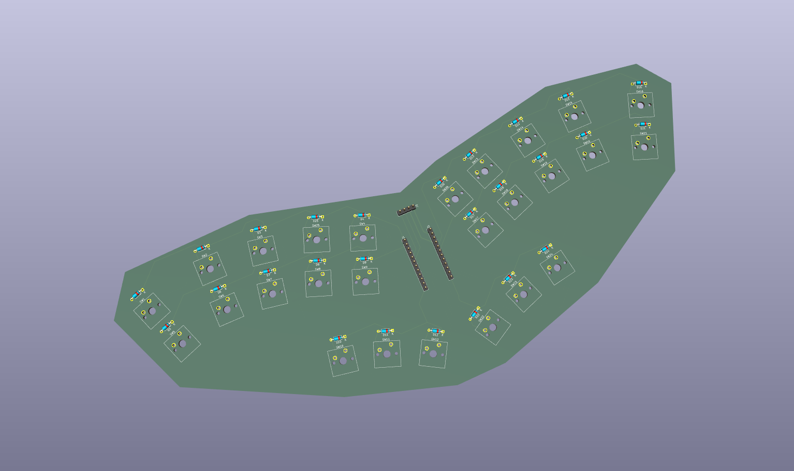

# Steno Keyboard

A 26-key phonetic steno keyboard: 10 keys per hand plus 6 thumb keys, an Arduino
Pro Micro, and a 128x32 I2C OLED.



## Contents

| Path | What it is |
|---|---|
| `Steno_Board/` | KiCad 10 project (schematic + PCB) |
| `Free_Coding_Project/steno_firmware/` | Pro Micro firmware (Arduino sketch) |
| `Free_Coding_Project/steno_interpreter.py` | Reads strokes over USB serial and decodes them to phonemes |

## Hardware

- Arduino Pro Micro (ATmega32U4, 5V/16MHz)
- 26 Cherry MX-compatible switches, 26 1N4148 diodes
- 0.91" 128x32 SSD1306 OLED module (I2C, address 0x3C), pins GND/VCC/SCL/SDA

Each hand has its own COL2ROW matrix wired only to its side of the Pro Micro:

| | Left hand (J1) | Right hand (J2) |
|---|---|---|
| Top row | r1 = D1 (TX) | r4 = D21 |
| Bottom row | r2 = D0 (RX) | r5 = D20 |
| Thumb row | r3 = D9 | r6 = D10 |
| Columns | c1-c5 = D4-D8 | c6-c10 = D19, D18, D15, D14, D16 |

OLED: SDA = D2, SCL = D3.

## Firmware

Requires the Adafruit SSD1306 and Adafruit GFX libraries. In the Arduino IDE,
select **Arduino Leonardo** and upload `steno_firmware.ino`.

When all keys are released, the firmware sends one packet per stroke:

```
0xFF, keys0, keys1, keys2, keys3, flags
```

`keys0` = L00-L06, `keys1` = L07-L12, `keys2` = R00-R06, `keys3` = R07-R12
(bit n = nth key). Data bytes only use bits 0-6, so they never collide with the
0xFF start byte. `flags`: bit0 left layer, bit1 thumb layer, bit2 right layer.

## Interpreter

```
pip install -r Free_Coding_Project/requirements.txt
python Free_Coding_Project/steno_interpreter.py COM5
```

Pass the Pro Micro's COM port (defaults to COM3).
